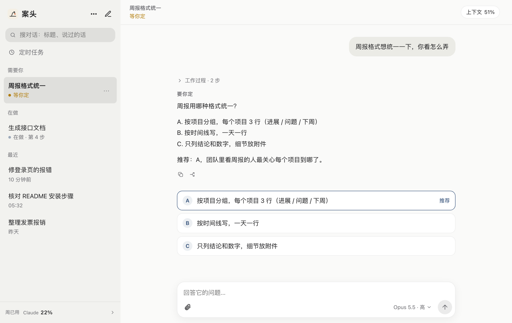
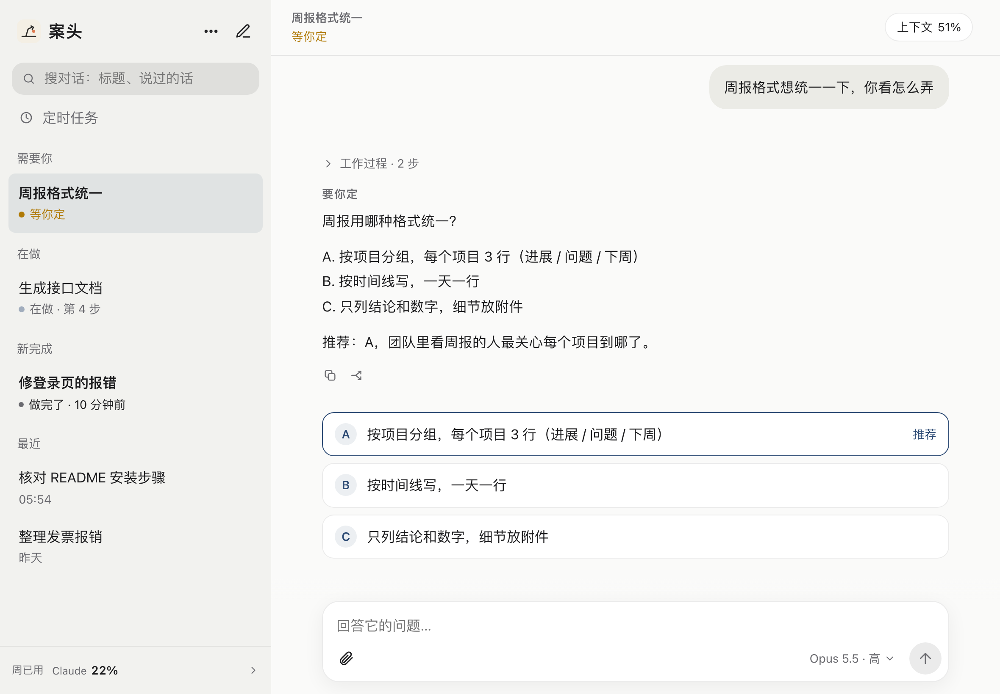
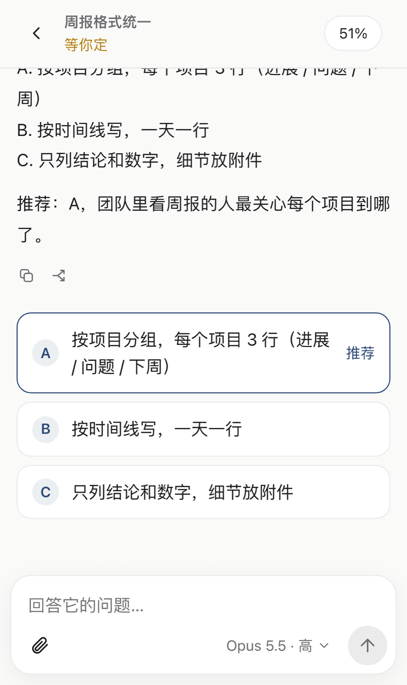

<h1 align="center">案头 · Anzhuo</h1>

<p align="center"><b>A Mac at home runs Claude / GPT. You steer it from any device with a browser.</b><br>
Phone, iPad or any computer — those devices need <b>no proxy and no installed software</b>. You only bring your own relay server.</p>

<p align="center">
  
  &nbsp;
  
  &nbsp;
  
</p>

> **Heads-up on language.** The UI, prompts and docs are in Simplified Chinese (the author's language). The code is plain Python + a single HTML file, so translating the UI is straightforward — contributions welcome. This page is a short English overview; the full documentation is in Chinese under [`docs/`](docs/).

## What it is

AI coding agents often work for ten minutes and then stop on a tiny question: *"A or B?"*, *"may I delete this file?"*. If you are away from your desk, they simply wait.

**Anzhuo (案头, "on the desk") moves that waiting to your phone.** It is a small Python service that runs on your own Mac:

- You send a message from any device → the Claude Code / Codex session on your Mac starts working.
- You see live progress: current step, a step progress bar, elapsed time, which files changed.
- When the agent needs a decision, the options become buttons (`A. … B. … Recommended: A`). One tap answers.
- Dangerous shell commands (`rm`, `git push`, `git reset --hard`, `sudo` …) pause and ask you to **Allow / Deny** first.
- When it finishes you get a push notification, plus screenshots / PDFs / any file it produced.

Nothing is opened on your computer's firewall: the web server only listens on `127.0.0.1`; you expose it yourself through a tunnel of your choice. All data stays on your machine.

## Features

- Several conversations in parallel (default 3, the rest queue), stored in Claude Code's / Codex's own session store — continue the same conversation from desktop, CLI or phone.
- Live progress, full "work process" view, interject while it is working, stop at any time.
- "Needs you" decisions rendered as buttons; quick replies; 3-second undo for one-tap answers.
- Dangerous-command confirmation, optional AI reviewer with a policy you write yourself (off by default).
- Web Push notifications (add to the iOS / iPadOS home screen; needs HTTPS), no duplicate alerts when you are looking at the conversation.
- Two-way file and image transfer (no count or size limit; plain files stream as-is); PDFs open directly, videos play while downloading.
- Claude can delegate image generation / editing to the local Codex image tool; real images come back into the reply.
- Optional read-aloud: Mandarin speech generated locally on the Mac (Apple Silicon, one-time model setup via `scripts/setup_speech.sh`).
- Rewind to an earlier message (optionally restore changed files), fork a conversation, copy replies — for both Claude and Codex.
- Scheduled tasks in natural language ("every Friday 3 pm summarize the week"), editable in the UI.
- Usage / quota display, context usage, auto "continue" after a 5‑hour limit resets.
- Claude (Claude Agent SDK) and GPT (the Codex bundled with the ChatGPT desktop app) behind one UI.
- Entry points: the web UI (default; any phone, tablet or computer with a browser) and an optional DingTalk bot.

## Quick start

Requirements: macOS (the only platform tested — it uses Keychain and launchd), [uv](https://docs.astral.sh/uv/) (installs Python 3.13+), a Claude account.

```bash
git clone https://github.com/EricChong02/anzhuo.git && cd anzhuo
uv sync

# Just look around — fictional conversations, no AI, nothing touched:
.venv/bin/python scripts/demo.py        # http://127.0.0.1:8799  (user: demo, password: demo)

# The real thing:
mkdir -p ~/.config/anzhuo && cp config.example.toml ~/.config/anzhuo/config.toml
scripts/claude_login.sh                 # log the bundled Claude Code in once
.venv/bin/anzhuo passwd                 # web login (password hash goes to the Keychain)
.venv/bin/anzhuo check                  # self-check
.venv/bin/anzhuo run                    # then open http://127.0.0.1:8765
scripts/install_launchd.sh              # optional: start at login, restart on crash
```

## What you need: three conditions

1. **A Mac at home that can reach Claude / GPT.** Install Anzhuo and Claude Code on it. *Only this Mac* needs access to the AI — if it needs a proxy, set that up on this Mac.
2. **A relay server of your own.** Anzhuo provides no relay service and the author's server is not available to anyone else. The repo ships one-shot scripts (SSH reverse tunnel + nginx + Let's Encrypt), so your Mac opens no inbound ports. Tailscale Serve and Cloudflare Tunnel also work without a server, but every client device must install Tailscale / depend on Cloudflare reachability (see [`docs/外网访问.md`](docs/外网访问.md)).
3. **Any device with a browser.** Phone, iPad, any computer: open your URL, log in. These devices need **no proxy and no installed software**.

## Security in four lines

1. Conversations run in "bypass permissions" mode so remote work is possible: **whoever logs in to the web UI controls your computer.** Use a strong password and HTTPS.
2. Only Bash commands are screened (regex rules + your approval). File edits are not. It is a seat belt, **not a sandbox**.
3. Anzhuo pre-authorizes nothing: commits, pushes and deploys ask you unless *you* say otherwise in the config (`extra_instructions`, `review_policy`).
4. Personal use only. Do not turn it into a shared service — that may violate the Claude / ChatGPT terms.

Anzhuo is an independent project, not affiliated with Anthropic, OpenAI or DingTalk. MIT licensed.
