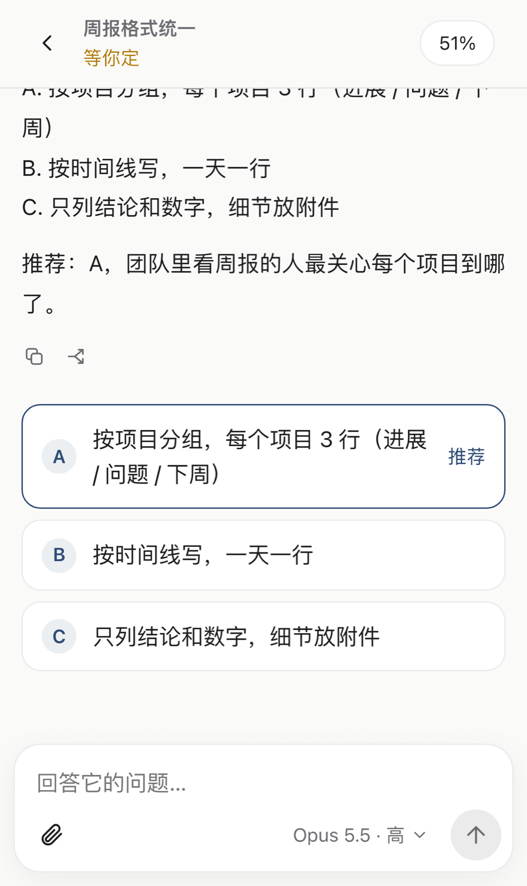
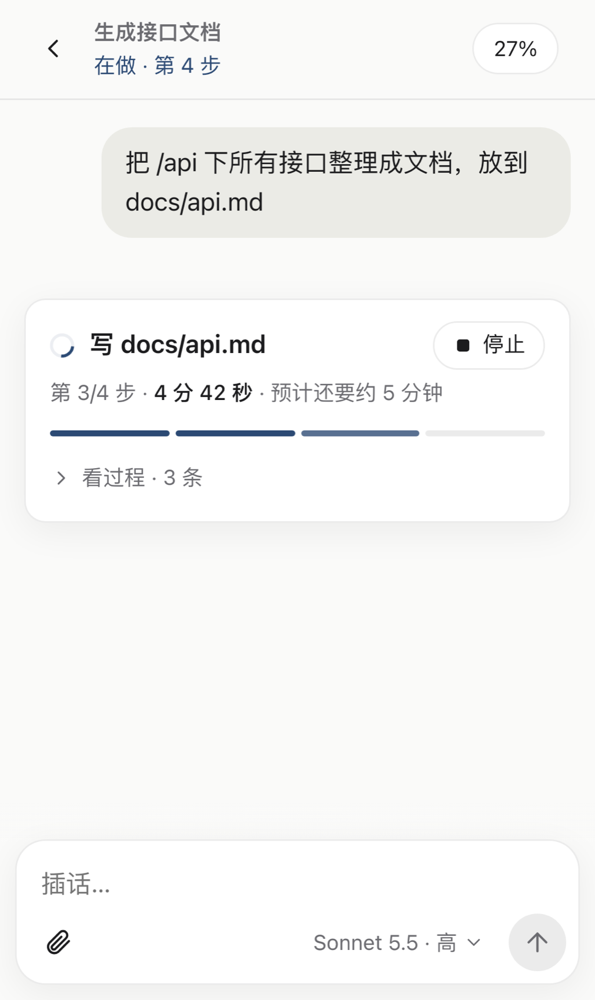
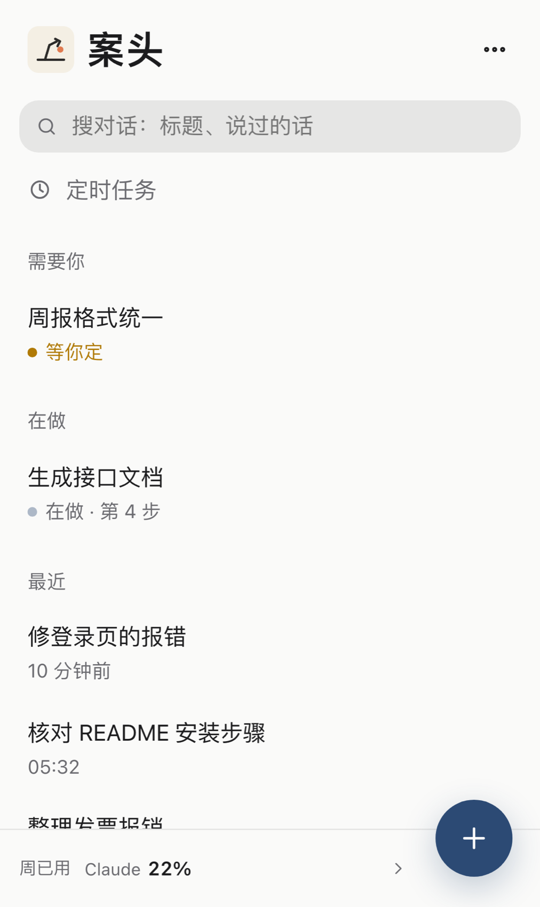
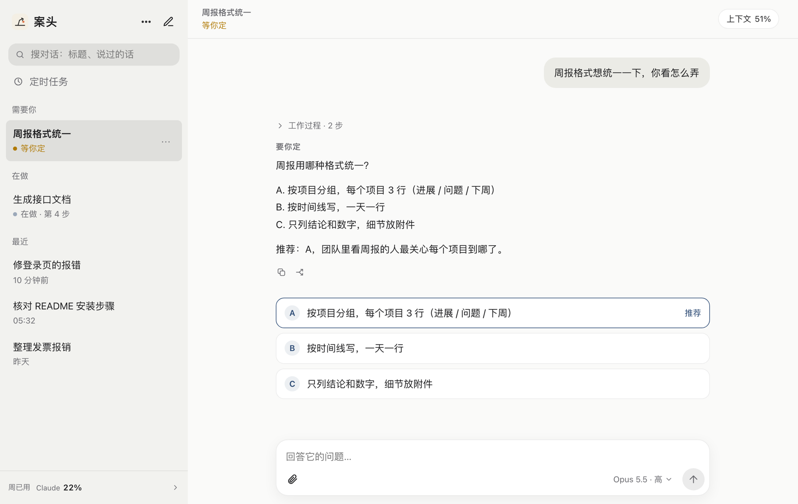

<h1 align="center">案头 · Anzhuo</h1>

<p align="center"><b>人不在电脑前，也能指挥电脑里的 Claude Code / Codex 干活。</b><br>
在任何地方、用任何设备，只要有浏览器，就能可视化地远程指挥家里的电脑：派活、看进度、点一下批准、收文件；钉钉可选。</p>

<p align="center">
  
  &nbsp;&nbsp;
  
  &nbsp;&nbsp;
  
</p>

<p align="center"><a href="README.en.md">English</a> · <a href="docs/安装与首次运行.md">安装</a> · <a href="docs/使用指南.md">使用指南</a> · <a href="docs/配置参考.md">配置参考</a> · <a href="docs/安全说明.md">安全说明</a> · <a href="docs/架构.md">架构</a></p>

---

## 它解决什么问题

Claude Code、Codex 这类 AI 编程助手，一个任务动辄做十几分钟。真正卡住它的，往往只是一句“选 A 还是 B”或者一次“可以删这个文件吗”。人一离开电脑，它就停在那里等。

**案头把“等你”这件事搬到手机上。** 它是一个跑在你自己电脑上的小程序：

- 你在手机上说一句话，电脑里的 Claude Code / Codex 就去做；
- 做的过程看得见：第几步、做了多久、改了哪些文件；
- 需要你定的时候，选项变成按钮，**点一下几秒钟搞定**；
- 要执行删文件、`git push` 这类危险命令时，先弹到你手机上等你点“允许”；
- 做完了弹手机通知，截图和文件直接发到你手里。

电脑不对外开放任何端口，所有数据留在你自己的电脑上。

## 功能一览

| | |
|---|---|
| **多对话并行** | 每个对话是一个独立的工作，默认最多同时 3 个，其余排队；对话存在 Claude Code / Codex 自己的目录里，桌面端、命令行、手机三边都能接着聊同一个对话 |
| **实时进度** | 一行写正在做的这一步，下面是步骤进度条和预计剩余时间；点开能看完整的“工作过程”（它说了什么、跑了什么命令、改了哪个文件） |
| **随时插话、随时停下** | 它正在做的时候你再说话，它做完手上这一步就会看到并调整 |
| **“要你定”变按钮** | 它把方案写成 A / B / C 加推荐，网页上自动变成可点的按钮；点了就把选择交回对话 |
| **危险命令先问你** | 删文件、`git push`、`git reset --hard`、`sudo` 等先停下，等你在网页或手机上点“允许”；也可交给另一个 AI 审核员代你判断（默认关） |
| **手机通知** | 加到 iPhone / iPad 主屏幕后，对话做完、等你回答、出错时弹系统通知；你正开着那个对话看就不重复打扰 |
| **文件和图片双向传** | 你可以发图、发文件（最大 300MB）；它做出来的截图、PDF、表格会直接交到你手里 |
| **回退、分叉、复制** | 回到某句话之前重新说（可选把改过的文件一起退回，Claude 和 Codex 都支持）；从某条回复另开一个分支；一键复制 |
| **定时任务** | “每天早上 8 点整理全球要闻”“两小时后接着这个对话做”，直接说就行，网页里能改、能暂停 |
| **额度与上下文** | 随时看 5 小时 / 本周额度和每个对话的上下文占用；撞到额度后，恢复一分钟自动说“继续” |
| **两个引擎** | Claude（Claude Agent SDK）和 GPT（ChatGPT 桌面版自带的 Codex），同一套界面 |
| **两个入口** | 网页（默认，手机电脑通用）；钉钉机器人（可选，适合想在聊天软件里指挥） |

<p align="center">
  
</p>

## 先看一眼：3 分钟演示（不连 AI，不花钱）

只想知道它长什么样？演示模式会起一个带虚构对话的案头，**不连 Claude、不碰你的文件夹和钥匙串**：

```bash
git clone https://github.com/EricChong02/anzhuo.git
cd anzhuo
uv sync                              # 需要 uv 和 Python 3.13+，见下面“安装”
.venv/bin/python scripts/demo.py     # 打开 http://127.0.0.1:8799 ，账号 demo，密码 demo
```

## 安装（真的接上你的 Claude）

**需要**：一台 Mac（目前只在 macOS 上验证）、[uv](https://docs.astral.sh/uv/)（会自动装好 Python 3.13+）、一个 Claude 订阅或 API 账号。想用 GPT 的话还要装 ChatGPT 桌面版并登录。

```bash
git clone https://github.com/EricChong02/anzhuo.git && cd anzhuo
uv sync                                                    # 1. 装依赖
mkdir -p ~/.config/anzhuo
cp config.example.toml ~/.config/anzhuo/config.toml        # 2. 放好配置（默认就能用，不用改）
scripts/claude_login.sh                                    # 3. 给案头用的 Claude Code 登录一次（浏览器里点授权）
.venv/bin/anzhuo passwd                                    # 4. 设置网页登录的账号和密码
.venv/bin/anzhuo check                                     # 5. 自检：配置、密码、Claude 登录是否都好了
.venv/bin/anzhuo run                                       # 6. 运行，然后浏览器打开 http://127.0.0.1:8765
```

确认能用之后，让它开机自启、崩了自动重启：

```bash
scripts/install_launchd.sh
```

完整步骤、每一步长什么样、出错怎么办，见 **[安装与首次运行](docs/安装与首次运行.md)**。

## 在手机上用

案头只听电脑本机的端口（`127.0.0.1`），手机要访问得有一条通路。

> **这条通路要你自己准备。案头不提供任何中转服务器，作者自己的服务器也不对外开放使用。** 下面三种方式，选一种：

1. **Tailscale Serve**：电脑和手机都装 Tailscale，一条命令把本机端口变成只有你的设备能打开的 HTTPS 地址，**不用服务器**；
2. **Cloudflare Tunnel**：有自己的域名的话，免费、不用服务器；
3. **你自己的服务器做中转**：需要自备一台有公网 IP 的服务器和一个域名；仓库里有现成脚本，一条 SSH 反向隧道 + nginx，电脑不用开放任何端口，作者本人长期这样用（用的是作者自己的服务器，别人用不了，请用你自己的）。

三种方式都要用 HTTPS（手机通知和主屏幕 App 需要）。详见 **[外网访问](docs/外网访问.md)**。

## 要在钉钉里指挥？（可选）

不填钉钉配置，案头就是纯网页版。想在钉钉里也能说话、收结果、点按钮，按 **[钉钉接入](docs/钉钉接入.md)** 建一个企业内部机器人（Stream 模式，不需要公网回调地址）。

## 先看这几句再用：安全

- 对话是以“跳过权限确认”的方式运行的（不然远程干不了活），**谁拿到你的网页登录，谁就能指挥这台电脑**。请设一个强密码，从外网访问时务必用 HTTPS。
- 只有 Bash 命令会被拦下来问你；文件的直接编辑不拦。它不是沙箱，**别当作能挡住恶意操作的防线**。
- 案头默认**不替你预先授权任何事**：提交、推送、部署都会问你。想让它少问，在配置里自己写（`extra_instructions` / `review_policy`），并清楚后果。

完整说明见 **[安全说明](docs/安全说明.md)**。

## 文档

| 想做什么 | 看这里 |
|---|---|
| 从零装好并跑起来 | [安装与首次运行](docs/安装与首次运行.md) |
| 学会网页和各种操作 | [使用指南](docs/使用指南.md) |
| 查某个配置项怎么写 | [配置参考](docs/配置参考.md) |
| 在钉钉里使用 | [钉钉接入](docs/钉钉接入.md) |
| 在外面用手机访问、收手机通知 | [外网访问](docs/外网访问.md) |
| 了解风险、做安全加固 | [安全说明](docs/安全说明.md) |
| 看懂代码怎么分工、数据存在哪 | [架构](docs/架构.md) |
| 遇到问题 | [常见问题](docs/常见问题.md) |
| 参与开发 | [CONTRIBUTING](CONTRIBUTING.md) |
| 转发给朋友的介绍 | [4 页 PDF](docs/promo/anzhuo-intro.pdf) · [手机竖图](docs/promo/cards/) |

## 现状与边界

- **平台**：目前只在 macOS 上用过（钥匙串、launchd、`caffeinate` 都是 macOS 的东西）。Linux / Windows 没有验证，欢迎贡献适配。
- **界面语言**：界面和提示是中文。
- **个人使用**：设计成“你自己在自己的电脑上用”。不要把它做成多人共用的服务——那样可能违反 Claude / ChatGPT 订阅条款，使用前请自己看一遍最新条款。
- **与官方的关系**：案头是第三方个人项目，和 Anthropic、OpenAI、钉钉没有关系；它调用的是官方的 Claude Agent SDK 和 Codex。

## 许可证

[MIT](LICENSE)
