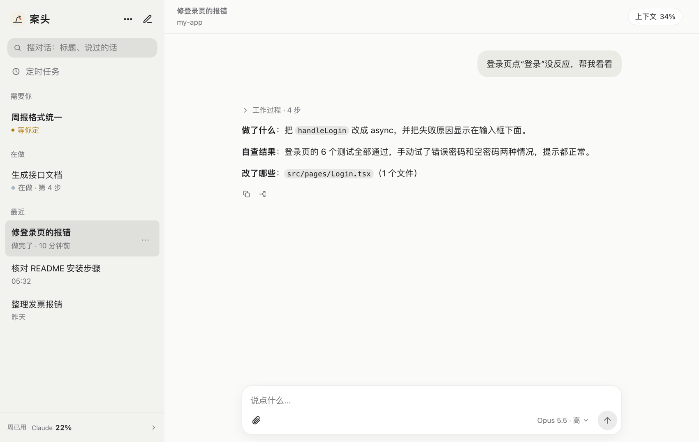
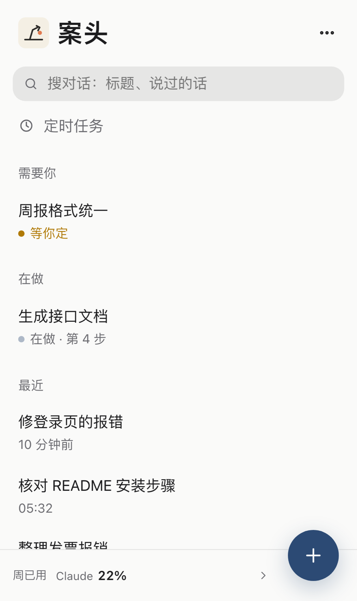
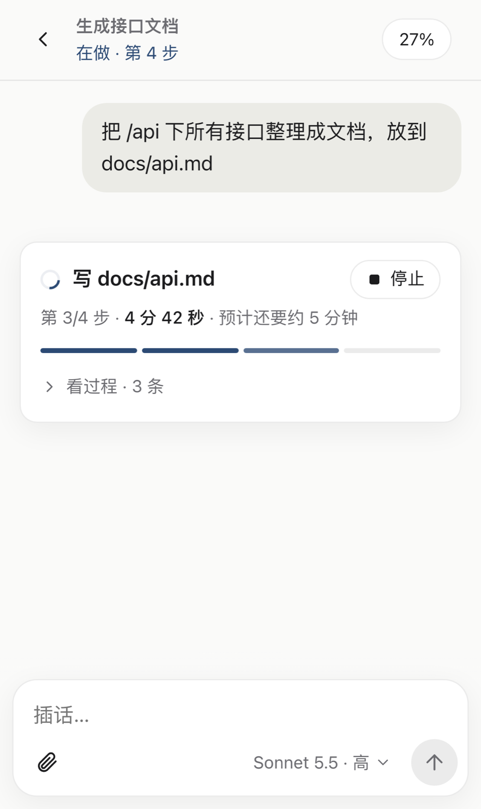
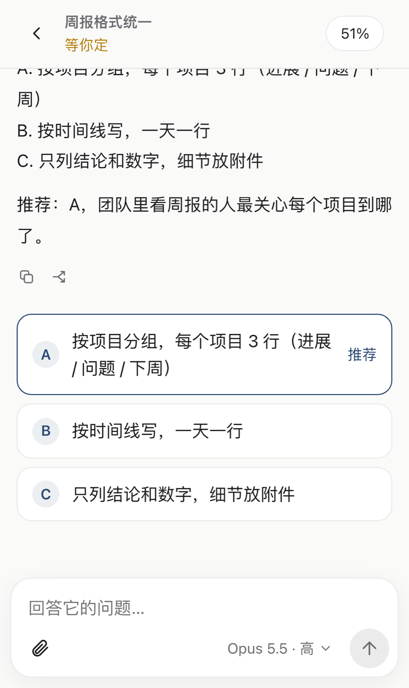
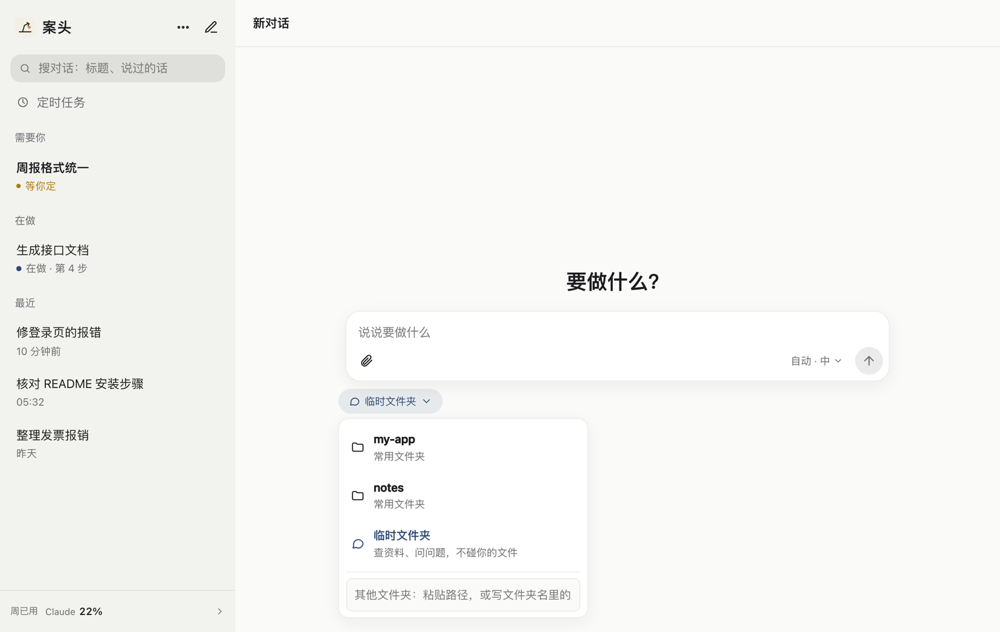
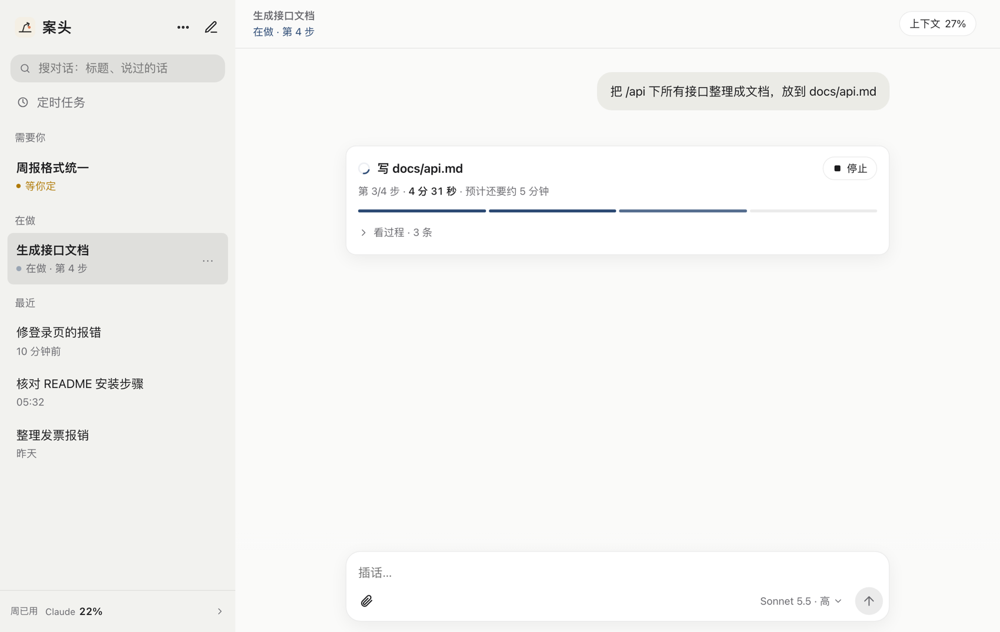
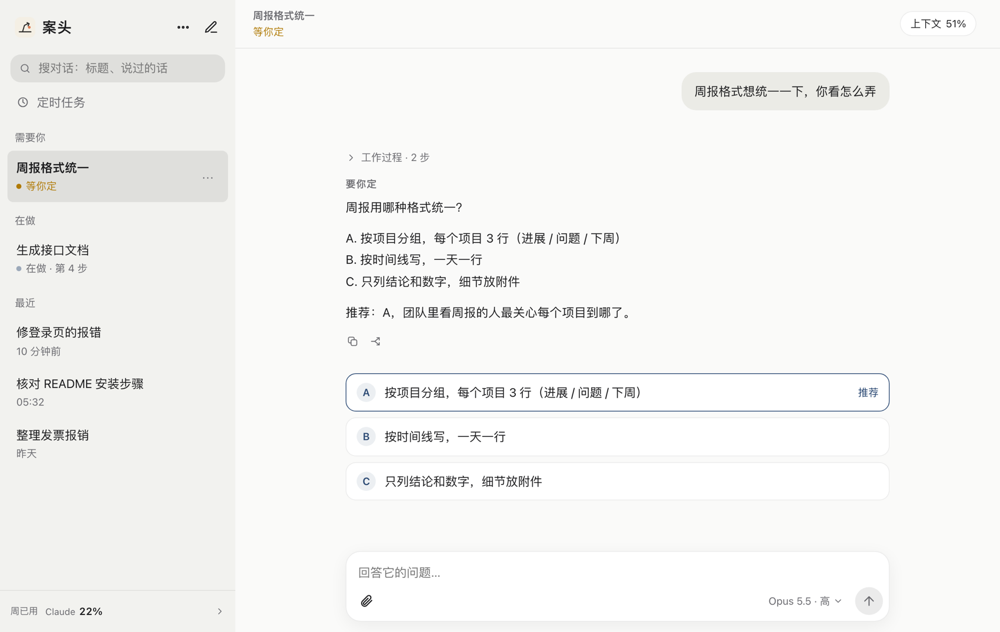

# 使用指南

装好之后怎么用。这一篇按“你会遇到的场景”来写，从第一个任务讲到定时任务和钉钉指令。

- [1. 界面导览](#1-界面导览)
- [2. 派第一个任务](#2-派第一个任务)
- [3. 看进度、插话、停下](#3-看进度插话停下)
- [4. 它要你定的时候](#4-它要你定的时候)
- [5. 危险命令：允许还是不允许](#5-危险命令允许还是不允许)
- [6. 收发图片和文件](#6-收发图片和文件)
- [7. 回退、分叉、复制](#7-回退分叉复制)
- [8. 上下文、额度和模型](#8-上下文额度和模型)
- [9. 定时任务](#9-定时任务)
- [10. 找对话、改名、删除、找回](#10-找对话改名删除找回)
- [11. 手机通知](#11-手机通知)
- [12. 钉钉里的说法](#12-钉钉里的说法)

---

## 1. 界面导览

**左边是对话列表**，按“要不要你出手”分组：

| 分组 | 意思 |
|---|---|
| **需要你** | 它在等你回答、批准或做决定。排在最前面，名字加粗，状态是琥珀色的“等你定” |
| **在做** | 正在干活，状态写“在做 · 第 N 步” |
| **新完成** | 刚做完、你还没看的回复，名字加粗 |
| **最近** | 其余的，按时间排；7 天没动的会自动收起 |

顶上：搜索框（搜标题、说过的话）、“定时任务”、右上角铅笔是**新对话**、“⋯”里是登录的设备和退出登录。最底下是额度，点开看 5 小时和本周的详情。

**右边是当前对话。** 标题下面一行是状态或工作文件夹；右上角的“上下文 34%”是这个对话已经用掉的上下文窗口；你说的话在右边，它的回复在左边，回复上面的“工作过程”点开能看它这一轮的每一步。

**手机上**是一栏：先是列表，点进去才是对话，从屏幕左边缘右滑返回；右下角的“＋”新开对话。

 &nbsp;  &nbsp; 

## 2. 派第一个任务

点铅笔（手机上是右下角的“＋”）：

1. **选工作文件夹。** 输入框下面的小按钮就是“在哪做”。点开有：
   - **最近用过的文件夹**（默认选中最近一次用的）；
   - **常用文件夹**（你在配置里起了短名的，见 [配置参考](配置参考.md#folders)）；
   - **临时文件夹**：一个空的临时目录，适合查资料、问问题，不碰你的任何文件；
   - 最下面的输入框：**粘贴一个路径**（如 `~/Projects/my-app`），或者写**文件夹名里的几个字**，案头会在 `search_roots` 里找；找到好几个或一个都找不到时，会直接告诉你，让你写完整路径。
2. **（可选）选模型和思考深度。** 输入框右下角的小按钮，例如“自动 · 中”。“自动”的意思是：文件夹里有 `.git`、`pyproject.toml` 或 `package.json`（看起来是个项目）就用开发模型（默认 Opus），否则用简单任务模型（默认 Sonnet）；这两个默认值可以在配置里改。菜单按 Claude / GPT 分组；一个对话从头到尾只能用同一家，换同一家里的型号会从下一句起生效。
3. **写要做的事，发送。** 文字、图片、文件都行。

对话会在“在做”里出现，可以放心离开。

## 3. 看进度、插话、停下

- 一大行写**正在做的这一步**，下面是“第 3/4 步 · 用时 · 预计还要多久”和一段**一步一格的进度条**。它有步骤清单时，进度条按清单走。
- “看过程”点开能看完整的步骤：它说了什么、跑了什么命令、改了哪个文件。
- **插话**：它正在做的时候，你直接在输入框里再说话（输入框会显示“插话…”），它做完手上这一步就会看到，并按你说的调整。发出去之后，你的话下面会写现在怎么样了：“已送到”“排队中”“插话”。
- **停止**：进度卡右上角的“停止”。
- 长时间没动静会提醒你：3 分钟没新动静轻提一句，10 分钟提醒可能卡住了。

## 4. 它要你定的时候

案头给每个对话加了一条约定：需要你在几个方案里选，就把第一行写成“要你定：……”，然后每个选项单独一行写成 `A. …`、`B. …`（最多 4 个），再单独一行写“推荐：A，理由”。案头会把它变成按钮——**点一下就把“选 A：……”交回对话**，对话立刻接着做。

另有几种“等你”的情形，案头会区分轻重：

- **等你定**（琥珀色，排最前）：要你定、列了方案、要你批准、直接问你问题；
- **有建议**（不标颜色）：活做完了，顺口问一句“要不要我再……？”，不算卡住。

输入框上方会按情形给**快捷回答**：批准编辑给“批准（N 处）”；是非题给“是 / 不是 / 先不做”；有建议给“好，做吧 / 不用了”；停了或出错给“继续”。点一下之后**3 秒内可以撤回**才真正发出去；长按则是填进输入框改一改再发。

## 5. 危险命令：允许还是不允许

对话是以“跳过权限确认”的方式运行的（这样它才能在你不在时顺手把事做完），所以案头在**Bash 命令**这一层加了一道闸：碰到下面这类命令，它会先停下，在网页上显示一张“等你确认”的卡片（连同手机通知），**你点“允许”才继续，点“不允许”或 20 分钟没回就当不允许**：

- 推送代码（`git push`）、丢掉改动（`git reset --hard`、`git clean -f`、`git checkout --` / `git restore`、`git stash drop`）、强删分支；
- 改数据库：`DROP TABLE`、`DELETE FROM`、`TRUNCATE`；
- `sudo`、`launchctl` 停服务 / 强制重启、抹盘分区、批量改权限、`find -delete`、在服务器上删东西或停服务；
- `rm` 删临时目录（`/tmp` 等）以外的东西。

> **这是安全带，不是沙箱。** 它只看 Bash 命令；文件的直接编辑（编辑 / 写入工具）不拦；规则是正则，绕得过去。详见 [安全说明](安全说明.md)。

想少点几下？可以开**AI 审核员**（配置 `auto_review = true`，默认关）：命中危险规则的命令先交给另一个 AI 结合“这一轮在做什么”判断放不放行；它出错或超时才退回来问你；放行或拦下都会写进这一轮的报告。它默认**不会放行推送、上线、部署**，除非你在 `review_policy` 里明说。见 [配置参考](配置参考.md#安全与整理)。

## 6. 收发图片和文件

- **你发给它**：输入框里的回形针选文件，或直接粘贴截图。图片会自动缩到 1600 像素；其他文件原样，最大 300MB。文件存进案头的收件箱，路径会告诉对话。
- **它交给你**：它做出截图，会直接显示在回复前面；它做出 PDF、表格、压缩包，会在回复里出现下载条，点一下下载（最多 10 个、每个 300MB）。图片和文件会复制一份到案头自己的数据目录，原处是临时目录被清掉了也能下载。

## 7. 回退、分叉、复制

- **复制**：每条回复和你说的话下面都有（电脑上悬停出现，手机上点一下气泡出现）。
- **回退**：你说的话下面的“回退”图标。回到这句话之前，这句和之后的内容收起，这句放回输入框让你改了再发；正在做就先停下。可以勾选“**同时恢复文件**”，把之后改过的文件也退回。发下一句之前还能撤销。
  - Claude 对话：用 Claude 自带的文件检查点；压缩点之前的回复不能回退。
  - Codex（GPT）对话：案头在每轮前后各记一份工作文件快照，恢复时先检查当前文件是不是还和那一轮结束时一致，**不一致就拒绝覆盖**，并保留一份撤销副本。快照存在数据目录 `checkpoints/`，不进你的 Git，单文件最多 300MB、每轮最多 1GB；案头不会自动清理它们。
- **分叉**：回复下面的“分叉”图标。从这条回复往下另开一个对话，带着这之前的来龙去脉，原对话不动。**注意：分叉只复制对话，不复制文件**，两边改的是同一个文件夹。

## 8. 上下文、额度和模型

- **上下文**：对话右上角的百分比。过 70% 会变成琥珀色提醒；点它有“压缩上下文”按钮（等于对话里跑 `/compact`），压完会报“59% → 12%”，之前的要点都还记得。对话正在做时点压缩，会排到这一轮之后。
- **额度**：左下角一格一个数，点开是 5 小时和本周的详情和重置时间。80%–90% 琥珀色，超过 90% 红色。用过 GPT 对话才会多出 GPT 那一列。
- **撞到 5 小时额度**：列表里灰色写“额度用完 · 17:40 恢复”，**恢复后一分钟自动替你说一句“继续”**（对话里能点“别自动接”关掉）。
- **换模型 / 思考深度**：输入框右下角的按钮。话里直接说也行：“用 opus”“深度调到高”。

## 9. 定时任务

侧栏的“定时任务”可以新建、看下次执行时间、修改、暂停 / 恢复、删除。频率是**单次、每天、每周**，使用你电脑当前的时区（或配置里的 `timezone`）。可以选模型、思考深度、工作文件夹，或者指定一个已有的对话（不指定就为这个任务新开一个专用对话，之后循环执行都接着它）。

也可以**直接说**，在新对话或钉钉里写：

- “明早 8 点整理全球要闻”
- “每天早上 8 点整理全球要闻”
- “每周五下午 3 点汇总周报”
- “两小时后接着这个对话做”

缺少明确时刻时它会要你补充，**不会把定时指令立刻当成任务去执行**。

要知道的规矩：

- 任务保存在数据目录的 `schedules.json`；**电脑关机、睡眠或案头没运行时不执行**，恢复后单次任务补做一次、循环任务只补最近一次；
- 目标对话正忙时会等，不会插进正在做的工作；
- 提交前先记下“执行凭据”，如果执行当中案头重启，任务会暂停并标“待确认”，让你看过对话再重新安排，避免重复执行；
- 暂停和删除只影响之后的计划，**不会停掉已经提交的工作**（要停去对话里点停止）；
- 创建时暂时只收文字，需要的文件请放在工作文件夹里。

## 10. 找对话、改名、删除、找回

- **搜索**：顶上的搜索框搜标题、你说过的话、它的回复；⌘K 直接聚焦搜索框。
- **改名 / 删除**：列表里每个对话右边的“⋯”（手机上长按）。名字在头一轮做完后会自动起一个短名，你手动改过就不再自动改。
- **删除只是“收起”**：从列表里消失，**聊天记录和附件都还在**；30 天内在搜索里点一下就能找回。7 天没动的对话、只聊了天没动过文件的对话（一天后）也会自动收起。
- 快捷键：⌘K 搜索、⌘N 新对话、⌘↑ / ⌘↓ 换对话。
- “⋯”里还有**登录的设备**：看有几台设备登录着，能退出任意一台（手机丢了就在这里全部退出）。

## 11. 手机通知

在手机上把案头**加到主屏幕**（iPhone / iPad：Safari 的分享菜单 → 添加到主屏幕），从主屏幕图标打开，侧栏会出现“开启手机通知”，点一下授权。要求：**用 HTTPS 访问**（见 [外网访问](外网访问.md)）、iOS / iPadOS 16.4 以上。

通知的规矩是“只来一次”：

- 你**正开着那个对话**在看（网页每 15 秒报一次“我在看”，切走、锁屏就不算）→ 什么都不发；
- 没在看 → 弹手机通知，写一句话说怎么样了（做完 / 等你定 / 出错）；
- 手机通知一台都没发到，并且开了钉钉 → 钉钉里说一句带链接的话。

## 12. 钉钉里的说法

> 只有开了钉钉入口才有这一节，见 [钉钉接入](钉钉接入.md)。钉钉是兜底入口：详细的过程、回退分叉、设置都在网页里。

**直接说话**就行：话交给当前对话（它在做事时就是插话）。“好的”“选 B”“继续”这类一看就是回复的话，会交给**正在等你回答**的那个对话。没有对话时先开一个。

| 说法 | 作用 |
|---|---|
| `新开 前端：要做的事` | 指定文件夹开新对话；文件夹写配置里的短名、完整路径，或文件夹名里的几个字（找到几个会让你回编号选） |
| `新开 前端 后端：…` | 同时用几个文件夹，第一个为主 |
| `新开：…` | 不指定文件夹，用临时文件夹 |
| `新建 位置/名字：…` | 先建文件夹再开工 |
| `列表`、`列表 全部` | 看对话（后者连收起的一起） |
| `切到 7` | 把当前对话换成 #7 |
| `#7 要说的话`，或引用某条消息再说 | 点名交给 #7 / 交给那条消息所属的对话 |
| `停`、`停 7` | 让当前对话 / #7 停下 |
| `删 7` | 收起 #7（聊天记录还在，发 `#7 …` 找回） |
| `改名 7 新名字` | 改名 |
| `模型 sonnet`、`深度 高`（可加编号） | 换模型（opus / sonnet / haiku / fable / 默认）、思考深度（低 / 中 / 高 / 很高 / 最高 / 默认） |
| `压缩`、`压缩 7` | 压缩上下文 |
| `额度` | 现查 5 小时和本周额度 |
| `网页` | 拿网页地址 |
| `接着桌面`（`接着桌面 2` 换第二段） | 接上你最近在桌面端聊的那段对话。**接上后桌面端那段先别再说话**，两边同时说会乱 |
| `最近 前端`、`接着 前端 2` | 列出某个文件夹最近的对话（含桌面端开的）并接着聊 |
| `帮助` | 看用法 |

钉钉里的小规矩：只发图不说话时，案头等 15 秒，你接着说的话会和图合成一件；语音直接用钉钉转好的文字；钉钉单个文件最大 20MB，超了会提示到网页下载；默认“安静模式”——钉钉只在有结果时弹（做完 / 等你定 / 出错 / 指令回话），开工、收到、插话这些过程消息只在网页里（`dingtalk_quiet = false` 恢复旧做法）。
